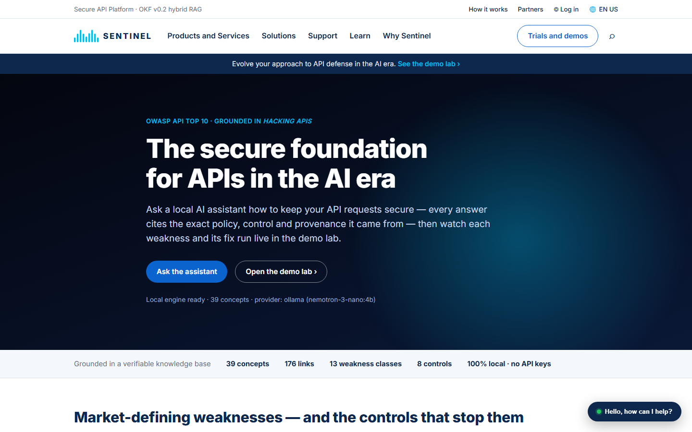
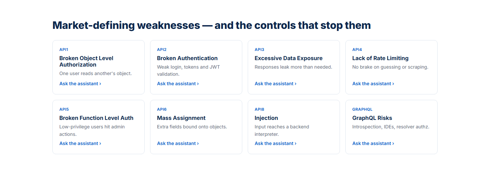
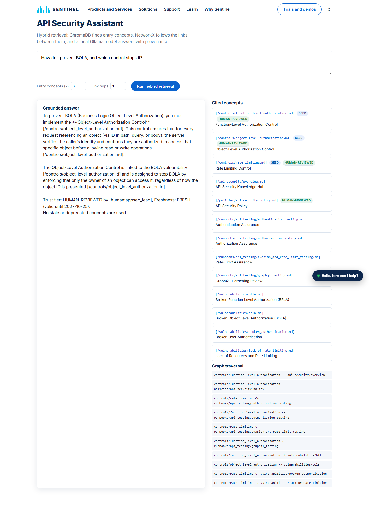
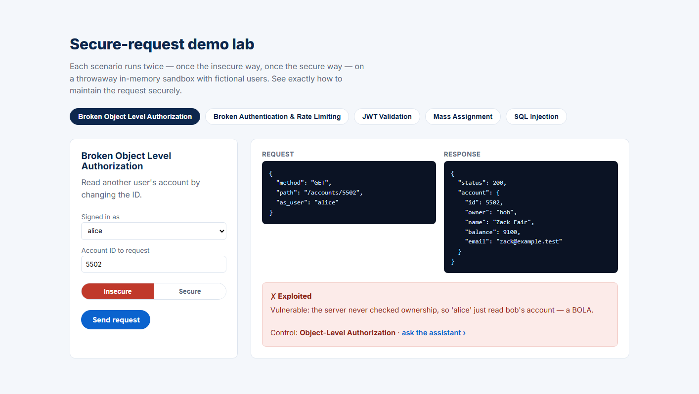
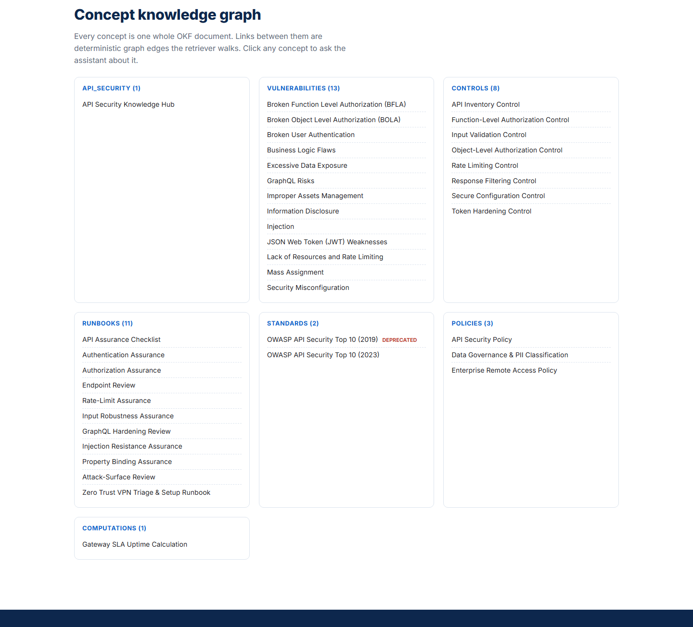

# 🛡️ OKF RAG Engine — API-Security Knowledge Assistant

A **hybrid Retrieval-Augmented Generation** application built on Google Cloud's
**Open Knowledge Format (OKF) v0.2**, with a defensive **API-security** knowledge base,
a **Cisco-style web experience**, an interactive **secure-request demo lab**, and a
**chatbot** that answers with provenance — all running **100% locally via Ollama, no API keys**.

> **Why it's different from a plain vector-RAG bot:** every OKF concept is a *whole document*
> (never chunked across boundaries), retrieval follows **explicit links** between concepts like a
> knowledge graph, and every answer is gated by **trust tier** and **freshness** so the assistant
> warns you when knowledge is stale or deprecated.

---

## ✨ Highlights

- 🔍 **Three-stage hybrid retrieval** — semantic entry points → deterministic link-graph expansion → trust/freshness gate.
- 🧠 **Local-first LLM** — chat + embeddings via **Ollama**; no keys, no data leaves the machine. Gemini/OpenAI remain optional.
- 📚 **Defensive API-security knowledge base** — distilled from *Hacking APIs* (Corey J. Ball) + the **OWASP API Security Top 10 (2019 & 2023)**: **13 weaknesses, 8 controls, 10 assurance checklists**.
- 🧪 **Secure-request demo lab** — each OWASP weakness shown **insecure vs. secured** on an in-memory sandbox (BOLA, auth/rate-limit, JWT `alg:none`, mass assignment, SQL injection).
- 🖥️ **Cisco-style web UI** — hero, trust bar, weakness tiles, assistant, demo console, concept graph, floating chatbot widget. Original **"Sentinel"** brand (*not affiliated with Cisco*).
- ✅ **Conformance-first** — a producer-side validator enforces OKF v0.2 (§11), and **28 offline tests** need no network or keys.

---

## 📸 Screenshots

**Home — the secure-API hero, trust bar and floating chatbot**



**Weakness catalog — the OWASP API Top 10, each linked to the assistant**



**API Security Assistant — a grounded, provenance-cited answer.** The answer names the exact
control, its **trust tier** (HUMAN-REVIEWED) and **freshness**, with the **cited concepts** and the
**deterministic graph-traversal path** shown alongside — generated locally by Ollama.



**Secure-request demo lab — BOLA, the insecure run.** Signed in as `alice`, requesting account
`5502` the insecure way returns **bob's** data — flagged *Exploited*, with the control that fixes it.
Flip to *Secure* and the same request is blocked.



**Concept knowledge graph — every concept grouped by type**, with the deprecated OWASP 2019
standard clearly flagged.



---

## 🏗️ Architecture

```
                   ┌───────────────────────────────────────────────────────────┐
  user question ──►│ 1. SEMANTIC ENTRY   ChromaDB → top-k whole OKF concepts     │
                   │ 2. GRAPH EXPANSION  NetworkX → follow Markdown links (N hops,│
                   │                     both directions)                         │
                   │ 3. TRUST & FRESHNESS render status / stale_after / verified  │
                   └───────────────────────────────┬───────────────────────────┘
                                                    ▼
        answer with [/path.md] citations ◄──  LLM (Ollama)  ──► + STALE / DEPRECATED warnings
```

| Stage | Component | What it guarantees |
|---|---|---|
| **1. Entry discovery** | `ChromaDB` + Ollama embeddings | Finds the most relevant *whole* concepts — no mid-concept chunking. |
| **2. Graph expansion** | `NetworkX` link graph | Deterministically pulls in linked policies, controls, runbooks & standards. |
| **3. Trust gate** | OKF v0.2 `status` / `stale_after` / `verified` | Answer cites provenance and **flags deprecated/stale** knowledge. |

---

## 🚀 Quick start (local, no API keys)

```bash
# 0. clone
git clone https://github.com/natrajexplore/OKF_RAG_Chatbot.git
cd OKF_RAG_Chatbot

# 1. install (uv + Python 3.12)
uv sync

# 2. local models (one-time) — requires a running Ollama daemon
ollama pull nemotron-3-nano:4b   # chat generation
ollama pull nomic-embed-text     # embeddings

# 3. config — defaults to fully-local Ollama, no keys
cp .env.example .env

# 4. sanity checks
uv run python -m src.validator   # 41 files, 0 errors
uv run pytest -q                 # 28 offline tests

# 5. run it
uv run uvicorn src.api:app       # web UI + chatbot + demo  → http://127.0.0.1:8000
uv run streamlit run src/app.py  # (optional) Streamlit workbench
```

Then open **http://127.0.0.1:8000/** and ask the chatbot a question like *"How do I prevent BOLA?"*.

> **CPU note:** `nemotron-3-nano:4b` on CPU answers in ~1 min for the default 3-concept context
> (`OKF_MAX_CONTEXT=3`). On a GPU, raise it for richer answers, or point `OLLAMA_MODEL` at
> `qwen2.5:7b-instruct`.

---

## 🌐 URLs & API reference

Served from a single origin (default `http://127.0.0.1:8000`):

| Surface | Method | Path | Purpose |
|---|---|---|---|
| **Web UI** | GET | `/` | Cisco-style site + chatbot + demo lab |
| API docs | GET | `/docs` | Auto-generated OpenAPI (Swagger) |
| Chat / Q&A | POST | `/api/chat` | RAG answer + citations + trust flags |
| Concept graph | GET | `/api/graph` | Nodes/edges for the knowledge graph view |
| Health | GET | `/api/health` | Provider, embedding mode, concept count |
| Demo list | GET | `/api/demo/scenarios` | The 5 secure-request scenarios |
| Run demo | POST | `/api/demo/{scenario}` | Replay a scenario insecure vs. secured |
| JWT sample | GET | `/api/demo/jwt/sample` | A sample token for the JWT demo |

**Example — chat:**
```bash
curl -s -X POST http://127.0.0.1:8000/api/chat \
  -H "Content-Type: application/json" \
  -d '{"query":"How do I prevent BOLA?","top_k":3,"hop_depth":1}'
```
Returns `{ answer, citations[], traversal[], trust_flags[], seed_ids[], expanded_ids[] }` —
the answer cites `[/controls/object_level_authorization.md]` with its trust tier, and
`trust_flags` warns that `owasp_api_top10_2019.md` is **DEPRECATED**.

---

## 🧪 Secure-request demo lab

Each scenario runs against an **in-memory sandbox** and shows the request/response **with the
weakness present** and then **with the control applied** — so you can see exactly what changes.

| Scenario | Weakness | Insecure behaviour | Secured behaviour |
|---|---|---|---|
| `bola` | Broken Object Level Authorization | Reads another user's record by changing the ID | Ownership derived from the token; same `404` either way |
| `auth` | Broken Auth & Rate Limiting | Unlimited password guesses | Attempts throttled and locked out |
| `jwt` | JWT Validation | Accepts a tampered `alg:none` token | Rejects unsigned / wrong-alg tokens |
| `mass` | Mass Assignment | Honours an injected `isAdmin` field | Binds only allow-listed fields |
| `injection` | SQL Injection | Concatenated query leaks data | Parameterised query neutralises input |

---

## 📚 API-security knowledge base

`okf_bundle/` holds a defensive knowledge base summarised from *Hacking APIs* (Corey J. Ball,
No Starch Press) and the OWASP API Security Top 10, framed throughout as **recognise → verify →
prevent** (no offensive step-by-step content):

| Group | Count | Examples |
|---|---|---|
| Hub & policy | — | `api_security/overview.md`, `policies/api_security_policy.md` |
| Standards | 2 | OWASP API Top 10 **2019** (deprecated) & **2023** |
| Weaknesses (`vulnerabilities/`) | **13** | BOLA, BFLA, broken auth, excessive data exposure, mass assignment, injection, JWT attacks, GraphQL, rate limiting, misconfig… |
| Controls (`controls/`) | **8** | object/function-level authorization, input validation, rate limiting, response filtering, token hardening, secure config, API inventory |
| Assurance checklists (`runbooks/api_testing/`) | **10** | recon, endpoint analysis, authn/authz testing, fuzzing, injection, mass-assignment, GraphQL, evasion/rate-limit |

**41 Markdown files, 39 concepts, 0 validator errors.** Every concept carries `sources`, bundle-absolute links, trust and freshness metadata.

---

## 🗂️ Project layout

| Path | Purpose |
|---|---|
| `okf_bundle/` | OKF v0.2 knowledge bundle — enterprise-ops samples **+ API-security base** (root `index.md`, `log.md`) |
| `src/okf_spec.py` | Spec constants & helpers (actors, staleness, trust tier, links) |
| `src/embeddings.py` | Embedding selection: Ollama (local), hashing (offline), or Chroma default |
| `src/validator.py` | §11 conformance errors + v0.2 trust/lifecycle/provenance/link warnings (`--strict` for CI) |
| `src/parser.py` | Tolerant consumer: loads concepts, builds the link graph, records broken links |
| `src/engine.py` | Hybrid retriever + **Ollama** / Gemini / OpenAI synthesis with a provenance-first prompt |
| `src/demo_lab.py` | Secure-request demo sandbox: insecure vs. secured per OWASP weakness |
| `src/api.py` | FastAPI backend (`/api/chat`, `/api/graph`, `/api/demo/*`) + serves `src/static/` |
| `src/static/` | Cisco-style single-page UI: hero, assistant, demo console, graph, chatbot widget |
| `src/app.py` | Streamlit workbench (chat / graph / conformance audit) |
| `tests/` | 28 offline tests (no network, no keys) |
| `.github/workflows/okf-validate.yml` | Validate + test on every PR |
| `CLAUDE.md` | OKF v0.2 rules & commands for Claude Code |

---

## ⚙️ Configuration (`.env`)

The default `.env` runs **fully local via Ollama**. Model names come from env vars, so nothing is hard-coded.

| Variable | Default | Meaning |
|---|---|---|
| `OLLAMA_MODEL` | `nemotron-3-nano:4b` | Local chat model. Unset → offline structured summary. |
| `OLLAMA_HOST` | `http://localhost:11434` | Ollama daemon URL (auto-normalised if set to `0.0.0.0`). |
| `OLLAMA_TIMEOUT` | `300` | Seconds to wait for a slow CPU generation. |
| `OKF_MAX_CONTEXT` | `3` | Max concepts' full text sent to the LLM (citations still show all). |
| `OKF_EMBEDDING` | `ollama` | `ollama` \| `hash` (offline) \| `default` (Chroma MiniLM). |
| `OLLAMA_EMBED_MODEL` | `nomic-embed-text` | Local embedding model. |
| `CHROMA_PATH` | *(unset)* | Set e.g. `.chroma` to persist the vector index between runs. |
| `OKF_BUNDLE_PATH` | `okf_bundle` | Path to the OKF bundle. |
| `GEMINI_API_KEY` / `OPENAI_API_KEY` | *(unset)* | Optional frontier providers (used only if Ollama is not configured). |

---

## 🧰 Commands

```bash
uv sync                               # install deps
uv run python -m src.validator        # validate bundle (add --strict to fail on warnings)
uv run pytest -q                      # 28 offline tests
uv run uvicorn src.api:app            # web app  → http://127.0.0.1:8000
uv run streamlit run src/app.py       # Streamlit workbench
```

After any change under `okf_bundle/`: run the validator (must be **0 errors**) and add a dated
entry to `okf_bundle/log.md`.

---

## 🧩 Using your own knowledge

Replace or extend `okf_bundle/`. Each concept is one Markdown file whose only required frontmatter
key is `type`; add `title`, `description`, `status`, `stale_after`, `sources`, `generated` and
`verified` to get trust and freshness signals in answers. Link concepts with bundle-absolute links
such as `[VPN runbook](/runbooks/zero_trust_vpn.md)`.

---

## 🧯 Troubleshooting

| Symptom | Cause / fix |
|---|---|
| `/api/health` shows `"provider":"offline"` | No `OLLAMA_MODEL` in env — `cp .env.example .env` and restart. |
| `unknown url type: '0.0.0.0/...'` | System `OLLAMA_HOST=0.0.0.0`; code normalises to `127.0.0.1:11434` — ensure you're on the current `src/embeddings.py`. |
| Chat is very slow / times out | CPU inference. Keep `OKF_MAX_CONTEXT=3`, raise `OLLAMA_TIMEOUT`, or use a GPU / smaller model. |
| First run downloads ~80 MB | `OKF_EMBEDDING=default` pulls Chroma's MiniLM; use `OKF_EMBEDDING=ollama` or `hash` to avoid. |
| Port 8000 busy | `uv run uvicorn src.api:app --port 8080`. |

---

## 🔒 Ethics & scope

The knowledge base and demo lab are **defensive**: they teach how to *recognise, verify and
prevent* API weaknesses, and the sandbox runs only against an in-memory toy app. No offensive
step-by-step exploitation content is included.

> **UI disclaimer:** the web front end mimics the *look and feel* of cisco.com for the demo
> experience only. It uses an original **"Sentinel"** brand and is **not affiliated with, or
> endorsed by, Cisco Systems, Inc.** *Hacking APIs* is © Corey J. Ball / No Starch Press and is
> **not** redistributed in this repository.

---

## 🤝 Working with Claude Code

Open the folder and run `claude`. `CLAUDE.md` gives it the OKF v0.2 rules, so prompts like
*"convert `docs/firewall-standard.pdf` into OKF concepts and link them to the API security policy,
then run the validator"* work without re-explaining the format.
